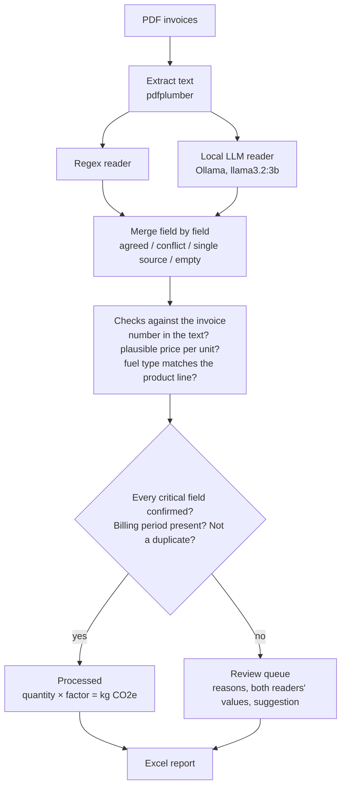

# invoice-to-emissions

I built this tool to read utility and fuel invoices (PDF), extract the consumption data and calculate greenhouse gas emissions automatically.

The calculation itself is one line: **quantity × emission factor**. The hard part is reading the right number with the right unit from invoices that all look different. So most of this project is about reading carefully, checking what was read, and knowing when *not* to trust it.

My main goal is **zero silent errors**: an invoice is only processed automatically when every critical value is confirmed. Everything else goes to a human, with the reasons and, where possible, a suggestion.

## How it works



- **Two readers.** A regex reader is fast and predictable but finds nothing when the layout changes. A local LLM reader adapts to new labels and languages but is sometimes confidently wrong. I use both and compare them.
- **Checks against the invoice itself.** A number must actually appear in the invoice text, the price per unit must be plausible, and the fuel type must match the product line (not the supplier's name).
- **Decision policy.** The invoice type must be confirmed by both readers. Quantity, unit and fuel type must be confirmed by both readers or by the checks. Conflicts always go to review.
- **Output.** One Excel workbook with three sheets: results with emissions, the review queue, and a summary by scope.

Emission factors: UK Government GHG Conversion Factors 2025 (DESNZ), see `data/emission_factors.csv`.

## Results

I generated the invoices myself with scripts so that I know the correct answer for every one of them. There are three sets:

- **Standard set (16 invoices):** three templates. I used this set to develop the rules and the prompt.
- **Messy set (13 invoices):** hand-designed, each with one deliberate twist (unfamiliar labels, European number formats, unknown fuel names, another language). This was the first final exam. I wrote my predictions down and committed them before the official run (`docs/final-exam.md`).
- **Fresh set (25 invoices):** designed after the messy set, with an ideal outcome for every invoice (process, review or either). The system had never seen it. One official run, with the design and the predictions committed beforehand (`docs/fresh-set-design.md`, `docs/fresh-set-predictions.md`).

Final exam on the messy set, one official run:

| | Regex | LLM |
|---|---|---|
| Invoices fully correct | 1/13 | 9/13 |
| Critical fields correct | 5/13 | 11/13 |
| Silent critical errors | 1 | 2 |

The LLM read far more, but it silently got two invoices wrong: it read `842 KWH` as 842000 (emissions 1000 times too high), and it called a diesel invoice petrol because the supplier was named "RoadStar Petrol". These two errors shaped the rest of the design.

How each layer handled the messy set:

| Approach | Processed and correct | Sent to review | Silent errors |
|---|---|---|---|
| LLM alone | 11 | 0 | 2 |
| Hybrid (both readers must agree) | 5 | 8 | 0 |
| Policy (agreement or checks) | 8 | 5 | 0 |
| Full pipeline (+ billing period and duplicate checks) | 6 | 7 | 0 |

On the standard set the full pipeline processes 16/16 invoices, and the total (16.671 tCO2e) matches the total calculated from the ground truth.

**Important:** I used the messy set while designing the hybrid and the policy, so the numbers above are a demonstration, not independent evidence. The real test is the fresh set.

### Fresh set: one official run

Twists include a Turkish invoice, a reactive energy line, a credit note, a duplicate, gas in MWh and two tariff lines that have to be added up.

| Outcome | Invoices |
|---|---|
| Processed automatically and correct | 14 |
| Silent errors | 0 |
| Sent to review and it should have been | 6 |
| Sent to review, acceptable (ambiguous invoices) | 2 |
| Sent to review although it could have been processed | 3 |
| Crashes | 0 |

The 14 processed invoices add up to exactly the ground truth total (9.945 tCO2e, deviation +0.00 %) and cover 89.7 % of the ideal total emissions.

What this does not show: it is a small synthetic set, designed by someone who knew the weaknesses of the system, with one run of a deterministic model. Two of the six needed reviews (a credit note and gas in MWh) happened for incidental reasons. The gaps I found are listed in `docs/fresh-set-results.md` and go to the v2 backlog. The fresh set is now used up: any new claim needs a new unseen set.

Details: `docs/llm-experiments.md`, `docs/final-exam.md`, `docs/hybrid-results.md`, `docs/fresh-set-results.md`.

## How I worked

- I kept a development set and a test set, and did not tune anything on the test set.
- Before every official run I wrote my predictions down and committed them. After the run I reported the results as they were, and treated the used set as "burned".
- I separate **missed** values (nothing found, safe: a human fills it in) from **wrong** values (dangerous: they go silently into the report).
- From the hybrid step on, I wrote the tests before the code (red, then green). There are 111 tests.
- I wrote the code together with an AI assistant (Claude), which also acted as a tutor and explained every step. I chose the project and its scope, decided that conflicting readings always go to a human, asked how flagged invoices would reach a reviewer (which became the review queue sheet of the Excel report), proposed country-aware emission factors (planned for v2), wrote my own predictions for the fresh set before the official run, ran the commands and reviewed the results. Every number in this README comes from running the code on the committed data.

## Setup

Requirements: Python 3.11, [Ollama](https://ollama.com) for the LLM reader.

```bash
conda create -n invoice-emissions python=3.11
conda activate invoice-emissions
pip install -r requirements.txt
ollama pull llama3.2:3b
```

To use another model, set the `OLLAMA_MODEL` environment variable (default: `llama3.2:3b`).

## Usage

Run the tests (no Ollama needed, the LLM is replaced by a stand-in):

```bash
pytest
```

Process a folder of invoices (Ollama must be running):

```bash
python -m scripts.run_pipeline --pdf-dir data/sample_invoices --out output/pipeline
```

This writes `results.csv`, `review_queue.csv` and `results.xlsx` to the output folder.

Measure the readers against the ground truth:

```bash
python -m scripts.evaluate --method rules
python -m scripts.evaluate --method llm
python -m scripts.evaluate_policy --truth tests/ground_truth_messy.csv --pdf-dir data/messy_invoices
```

Judge every invoice against its ideal outcome (the fresh set, already used for the official run):

```bash
python -m scripts.evaluate_fresh
```

Inspect one invoice (both readers, the merge status and the checks):

```bash
python -m scripts.explain_invoice data/messy_invoices/INV-M-02.pdf
```

## Project structure

```
src/
  extract_rules.py   PDF text and the regex reader
  extract_llm.py     local LLM reader (Ollama)
  hybrid.py          field-by-field merge of the two readers
  validate.py        number-in-text and price plausibility checks
  products.py        fuel type check against the product line
  policy.py          processed or review, with reasons and suggestions
  pipeline.py        end to end: folder in, results and review items out
  report.py          Excel workbook
  schema.py          invoice data model (Pydantic)
  factors.py         emission factor lookup and unit conversion
  calculate.py       emission calculation
scripts/             invoice generators, evaluation, pipeline run
tests/               unit tests and ground truth files
data/                synthetic invoices and the emission factor table
docs/                experiment log, final exam, fresh set design and results, roadmap
```

## Limitations

- Synthetic invoices only, and small test sets (16, 13 and 25 invoices).
- UK DESNZ 2025 factors are applied to every invoice, whatever the country.
- A small local model (llama3.2:3b).
- No scanned invoices (no OCR).
- Difficult invoices go to review often: 7 of 13 on the messy set and 11 of 25 on the fresh set (3 of them unneeded). That is the price of zero silent errors, and it will need to come down for real use.
- The fresh set result is one run of a deterministic model: a trend, not a guarantee. The gaps it showed are in `docs/fresh-set-results.md`.
- Known problems with real invoices are listed in `docs/real-world-risks.md`.

## Roadmap

- **v1.0:** this release.
- **v1.1:** Streamlit interface.
- **v2:** country-aware emission factors (see `docs/country-factors-design.md`), the gaps found on the fresh set (credit notes, space-grouped thousands, invoice type labels, summing tariff lines, gas in MWh) and a larger model compared on a new unseen set.

See `docs/roadmap.md`.

## License

MIT
